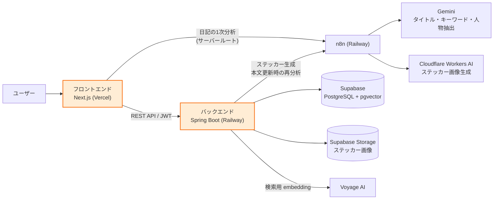
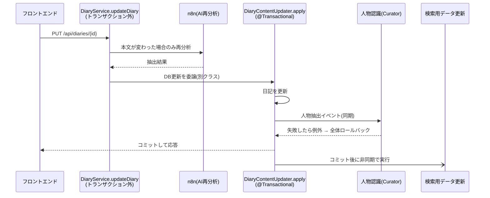
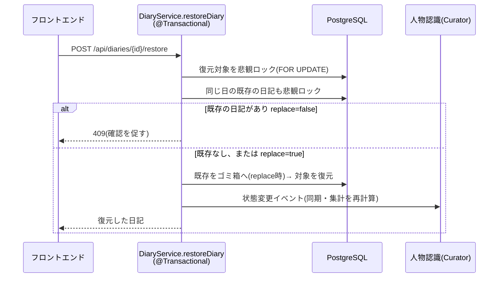

## アーキテクチャ

### システム構成



オレンジの枠が私の担当範囲です(カレンダー・日記の画面、日記・カレンダーAPI)。
画面は1つのページに、モーダルやパネルを重ねる構成です(ページ遷移なし)。

### 日記を更新するときの流れ



| ポイント | 内容 |
|---|---|
| AI呼び出しはトランザクションの外 | 待ち時間にDB接続を占有しない |
| DB更新は別クラスに分離 | 同じクラス内の呼び出しでは `@Transactional` が効かない(プロキシを通らない)ため |
| 人物認識は同じトランザクション | 失敗したら日記の更新も取り消される(DB変更のみ。外部の画像などは対象外) |
| 検索用データの更新はコミット後 | 失敗しても日記の保存には影響しない |

### ゴミ箱から復元するときの流れ



| ポイント | 内容 |
|---|---|
| 二重の防御 | DB制約(同じ日のACTIVEは1件)とロックを併用し、同時操作でも制約違反エラーにならず1件のまま |
| 入れ替えは1トランザクション | 既存をゴミ箱へ送る処理と復元を同時に行い、途中失敗でも中途半端な状態を残さない |
| 完全削除 | 利用者の操作では行わず、30日経過後に自動削除バッチが実行する |

### ディレクトリ構成

```
バックエンド  src/main/java/com/tada/tada/
├── global/     設定・セキュリティ・共通例外・イベント
├── auth/       ログイン・トークン
├── diary/      日記(私の担当)
├── calendar/   カレンダー(私の担当)
├── search/     検索
└── curator/    人物認識

フロントエンド  domains/
├── calendar/ diary/ sticker/ search/ curator/ auth/ guest/
└── shared/     共通部品(api-client, token-store など)
```
