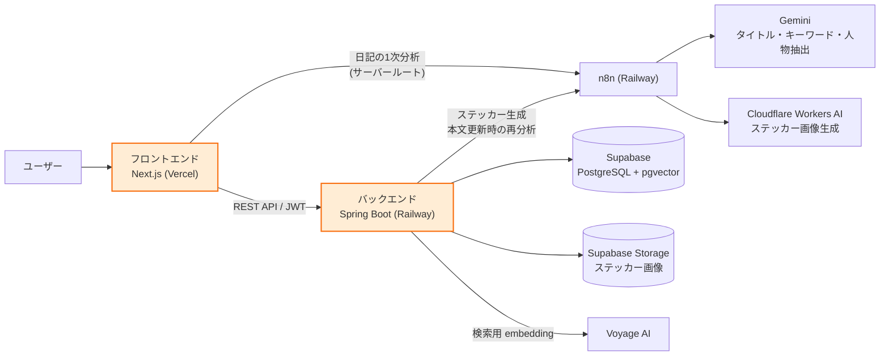
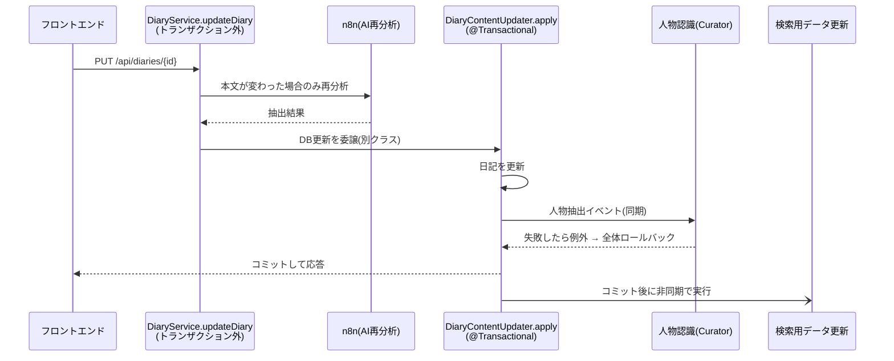
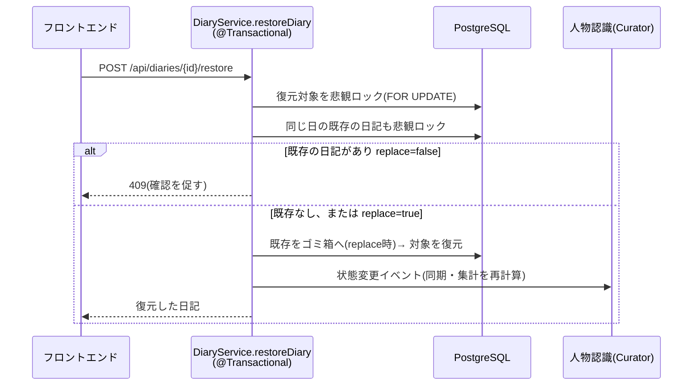

[日本語](README.md) | [한국어](README.ko.md)

# TADA — AI絵日記サービス


> 日記を書くと、AIが一日を1枚のステッカーにしてカレンダーに残してくれるサービスです。

チーム開発(5名・約2ヶ月)のうち、私が担当した部分を紹介します。

- フロントエンド:[idlms9/tada-frontend](https://github.com/idlms9/tada-frontend)
- バックエンド:[idlms9/tada-was](https://github.com/idlms9/tada-was)
- 元リポジトリ:[OhSSangHoon/tada-frontend](https://github.com/OhSSangHoon/tada-frontend)、[OhSSangHoon/tada-was](https://github.com/OhSSangHoon/tada-was)

## 担当

**フロントエンド**
- 月間カレンダー画面(CSS Gridで自作、年月ホイールピッカー)
- 日記の作成・詳細モーダル
- ゴミ箱パネルとドラッグ&ドロップ削除
- API連携・エラー処理

**バックエンド**
- 日記CRUD API(作成・取得・更新・ゴミ箱・復元)
- カレンダーAPI(月別のステッカー取得)
- ゴミ箱の30日後自動削除バッチ、未使用ステッカー画像の自動清掃バッチ
- 本文更新時のAI再分析の連携、人物認識(Curator)との同期イベント連携

## 設計で考えたこと

- **中途半端な日記を残さない**:日記・ステッカー・人物認識を1つのトランザクションで保存し、失敗したらDB変更を全て取り消します。
- **安心して使えるように**:1日1件・新規作成は1日5回まで。消してもゴミ箱から戻せます。戻す日に日記がある場合は、確認してから入れ替えます。
- **待ち時間でDBを占有しない**:AIの呼び出しはトランザクションの外で行い、結果を検証してから短いトランザクションで保存します。

## アーキテクチャ

### システム構成



オレンジの枠が私の担当範囲です(カレンダー・日記の画面、日記・カレンダーAPI)。
画面は1つのページに、モーダルやパネルを重ねる構成です(ページ遷移なし)。

### 日記を更新するときの流れ



- **AI呼び出しはトランザクションの外**:待ち時間にDB接続を占有しません。
- **DB更新は別クラスに分離**:同じクラス内の呼び出しでは `@Transactional` が効かない(プロキシを通らない)ためです。
- **人物認識は同じトランザクション**:失敗したら日記の更新も取り消されます(対象はDB変更のみで、外部の画像などは含みません)。
- **検索用データの更新はコミット後**:失敗しても日記の保存には影響しません。

### ゴミ箱から復元するときの流れ



- **二重の防御**:DB制約(同じ日のACTIVEは1件)とロックを併用し、同時に操作しても制約違反エラーにならず1件のままです。
- **入れ替えは1トランザクション**:既存をゴミ箱へ送る処理と復元を同時に行い、途中で失敗しても中途半端な状態を残しません。
- **完全削除**:利用者の操作では行わず、30日経過後に自動削除バッチが実行します。

## 担当API

| メソッド | パス | 内容 |
|---|---|---|
| POST | /api/diaries | 日記の最終保存 |
| GET | /api/diaries/{id} | 日記の取得 |
| PUT | /api/diaries/{id} | 日記の更新 |
| DELETE | /api/diaries/{id} | ゴミ箱へ移動 |
| POST | /api/diaries/{id}/restore | ゴミ箱から復元 |
| GET | /api/diaries/trash | ゴミ箱の一覧 |
| GET | /api/diaries/can-create | 作成可否の確認 |
| POST | /api/diaries/generate-sticker | ステッカー生成 |
| DELETE | /api/diaries/{id}/permanent | 完全削除(バッチが利用) |
| GET | /api/calendar | 月別のステッカー取得 |

## 課題と対応

**① @Transactionalが効かない**
- 状況:本文更新で、AI再分析の待ち時間もDB接続を占有する恐れがあった
- 原因:同じクラス内の呼び出しは `@Transactional` が効かない(プロキシを通らない)
- 対応:DB更新とイベント発行を別クラス(`DiaryContentUpdater`)に分け、AI呼び出しはトランザクションの外へ
- 結果:AI待ちでDBを占有せず、人物認識が失敗したら更新も一緒に取り消される

**② 復元の同時操作(排他制御)**
- 状況:「確認→復元」の間に別の操作が入ると、制約違反エラーで失敗する恐れがあった
- 対応:復元する日記と、同じ日の既存の日記に悲観ロック(FOR UPDATE)をかけた
- 結果:同時に操作しても、エラーにならず日記は1件のまま

**③ ログイン直後にカレンダーが更新されない(フロントエンド)**
- 状況:再読み込みするまで、認証状態がカレンダーに反映されなかった
- 原因:トークンの変化が画面に伝わらず、カレンダーのデータが再取得されなかった
- 対応:トークンを購読可能な状態(`useAccessToken`)にし、ログイン成功時・トークン復元時にカレンダーのクエリを再取得させた

## テスト

- DiaryService(作成・更新・ゴミ箱・復元):18件
- DiaryContentUpdater(本文更新・イベント発行):5件
- StickerCleanupService(未使用画像の清掃):5件
- StickerObjectCleanupClient(ストレージ連携):5件
- DiaryAnalysisClient(n8n連携):3件

実行:`./gradlew test`

## 技術(私が使ったもの)

- **バックエンド**:Java 17、Spring Boot 3.5、Spring Data JPA、PostgreSQL
- **フロントエンド**:Next.js、TypeScript、TanStack Query、Tailwind CSS
- **テスト**:JUnit、Mockito

## ディレクトリ構成

```
バックエンド  src/main/java/com/tada/tada/
├── global/     設定・セキュリティ・共通例外・イベント
├── auth/       ログイン・トークン
├── diary/      日記(私の担当)
├── calendar/   カレンダー(私の担当)
├── search/     検索
└── curator/    人物認識

フロントエンド  domains/
├── calendar/ diary/ sticker/ search/ curator/ auth/ guest/
└── shared/     共通部品(api-client, token-store など)
```
